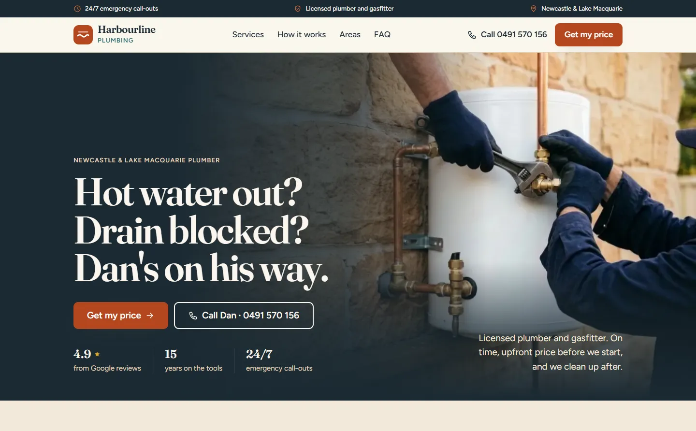
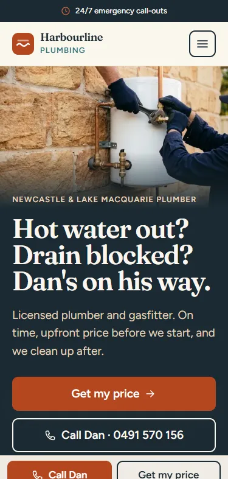

# Harbourline Plumbing

A one-page lead-generation website for a local plumber in Newcastle, NSW. It's a **demo concept**: Harbourline, Dan, the phone number and the reviews are all fictional.

**Live site:** https://harbourline-plumbing.vercel.app/



## The brief

Plumbing is an urgent purchase. Someone with no hot water or a blocked drain calls the first plumber who looks trustworthy and picks up. So the page has two goals: **get the call** and **get the quote request**. Both are always one tap away.

- The phone number appears in the header, hero, final CTA and footer. On mobile, a sticky call bar stays on screen.
- A short lead form (name, phone, suburb) sits right under the hero. It has inline validation, a hidden honeypot field to catch spam, and a clear success state.
- Buttons say what happens next ("Get my price", "Call Dan"), never "Submit".
- Proof builds up in order: trust stats, services, why choose us, recent jobs, sample reviews, how it works, meet Dan, service areas, then the FAQ.
- The tone is warm and plain, not techy. Headlines are broken by hand to read like speech.



## Built with

- **Next.js 16** (App Router), **React 19**, **TypeScript**
- **Tailwind CSS 4**, with hand-built components (no UI kit)
- `next/image` for every image, and `next/font` for Fraunces (display) and Figtree (body)
- **Resend** to email new quote requests through a server action
- **Plumber** and **FAQPage** JSON-LD schema, plus a sitemap, robots.txt and a generated Open Graph image
- Deployed on **Vercel**

## Quality

Lighthouse scores on the live site:

| | Performance | Accessibility | Best practices | LCP | CLS |
|---|---|---|---|---|---|
| Mobile | 97 | 100 | 100 | 2.5s | 0 |
| Desktop | 100 | 100 | 100 | 0.6s | 0 |

The SEO score is lower only because the demo is deliberately set to `noindex`. Full details are in [`qa/QA-REPORT.md`](qa/QA-REPORT.md).

## Project structure

```
app/          layout, page, metadata, icons, OG image, sitemap, robots, lead server action
components/
  layout/     header, mobile menu, sticky call bar, trust strip, footer
  sections/   hero, lead form, services, reviews, FAQ and the other page sections
  ui/         button, container, photo, count-up, scroll reveal
lib/          business facts (site.ts), page content, schema, lead validation
public/img/   optimised WebP photos
qa/           QA report and full-page screenshots
```

All business facts (name, phone, hours, area, services) live in `lib/site.ts`, so the whole site can be re-branded for a real business from one file.

## Run it locally

```bash
npm install
cp .env.example .env.local   # add a Resend API key and the email that receives leads
npm run dev                  # http://localhost:3000
```

---

Designed and built by **Jayson Clarit** · [jaysonclarit.com](https://jaysonclarit.com)
